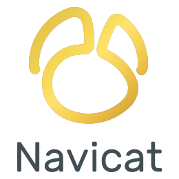

### Hi fellows 👋
- 🔭 I’m currently working on [Monitaz](https://monitaz.com/)
- 📫 How to reach me:

[](https://www.facebook.com/SuBiBi155)
[](https://teams.live.com/l/invite/FEATVANtpU_KFHnfA?v=g1)
[](https://www.linkedin.com/in/ti%E1%BA%BFn-%C4%91%E1%BA%A1t-l%C3%AA-ba267a232/)
[](https://t.me/subibi1505)
[](mailto:tiendat15599.dev@gmail.com)
[](mailto:tiendat15599@yahoo.com.vn)

[comment]: <> (### Spotify Playing 🎧)

[comment]: <> ([]&#40;https://open.spotify.com/user/21wi7t5t4zyugx5mgetrdo7xa&#41;)
### Last.fm Playing 🎧
[](https://www.last.fm/user/tiendat15599)

---

### Tools:



<br>

### Libraries and Frameworks:


<br>

### Databases:


<br>
<br>

---

[comment]: <> (![Lê Tiến Đạt's GitHub stats]&#40;https://github-readme-stats.vercel.app/api?username=tiendat15599&show_icons=true&count_private=true&theme=tokyonight&#41;)
### Development Stats


<!--START_SECTION:waka-->


**🐱 My GitHub Data** 

> 📦 284.1 kB Used in GitHub's Storage 
 > 
> 🏆 15 Contributions in the Year 2026
 > 
> 🚫 Not Opted to Hire
 > 
> 📜 28 Public Repositories 
 > 
> 🔑 27 Private Repositories 
 > 
**I'm an Early 🐤** 

```text
🌞 Morning                710 commits         ████████░░░░░░░░░░░░░░░░░   30.59 % 
🌆 Daytime                610 commits         ███████░░░░░░░░░░░░░░░░░░   26.28 % 
🌃 Evening                651 commits         ███████░░░░░░░░░░░░░░░░░░   28.05 % 
🌙 Night                  350 commits         ████░░░░░░░░░░░░░░░░░░░░░   15.08 % 
```
📅 **I'm Most Productive on Thursday** 

```text
Monday                   243 commits         ███░░░░░░░░░░░░░░░░░░░░░░   10.47 % 
Tuesday                  333 commits         ████░░░░░░░░░░░░░░░░░░░░░   14.35 % 
Wednesday                380 commits         ████░░░░░░░░░░░░░░░░░░░░░   16.37 % 
Thursday                 461 commits         █████░░░░░░░░░░░░░░░░░░░░   19.86 % 
Friday                   385 commits         ████░░░░░░░░░░░░░░░░░░░░░   16.59 % 
Saturday                 160 commits         ██░░░░░░░░░░░░░░░░░░░░░░░   06.89 % 
Sunday                   359 commits         ████░░░░░░░░░░░░░░░░░░░░░   15.47 % 
```


📊 **This Week I Spent My Time On** 

```text
💬 Programming Languages: 
Markdown                 8 hrs 35 mins       ███████████░░░░░░░░░░░░░░   42.67 % 
Other                    6 hrs 26 mins       ████████░░░░░░░░░░░░░░░░░   31.95 % 
Python                   2 hrs 46 mins       ███░░░░░░░░░░░░░░░░░░░░░░   13.75 % 
PHP                      1 hr 50 mins        ██░░░░░░░░░░░░░░░░░░░░░░░   09.14 % 
Text                     17 mins             ░░░░░░░░░░░░░░░░░░░░░░░░░   01.44 % 

🔥 Editors: 
Claude Code              9 hrs 48 mins       ████████████░░░░░░░░░░░░░   48.64 % 
FileZillaFTPClient       2 hrs 6 mins        ███░░░░░░░░░░░░░░░░░░░░░░   10.46 % 
PhpStorm                 2 hrs 4 mins        ███░░░░░░░░░░░░░░░░░░░░░░   10.31 % 
NavicatPremium           1 hr 56 mins        ██░░░░░░░░░░░░░░░░░░░░░░░   09.60 % 
PyCharm                  1 hr 50 mins        ██░░░░░░░░░░░░░░░░░░░░░░░   09.10 % 

💻 Operating System: 
Windows                  20 hrs 9 mins       █████████████████████████   100.00 % 
```

🤖 **AI Coding This Week** 

```text
⏱ AI Coding Time: 9 hrs 48 mins (48.64%)

✍️ 1,755 lines written by AI, 4,143 lines written by hand (29.76% AI-written)

🔤 12,380,301 Input Tokens, 2,181,946 Output Tokens

💵 $128.02 Estimated AI Cost This Week

🧠 17 AI Sessions, 94 AI Prompts

Opus                     1,299 lines         ██████████████████░░░░░░░   73.89 % 
Sonnet                   459 lines           ███████░░░░░░░░░░░░░░░░░░   26.11 % 

🔎 AI Coding Insights:
🧑‍💻 Mostly Hands-On — 29.76% of written lines came from AI
📚 Verbose Prompter — average 2,030 characters per prompt
🔁 Iterative Prompter — average 6 prompts per session
🔍 Hands-On Reviewer — 81.5% of changed lines were hand-edited
```

**I Mostly Code in PHP** 

```text
PHP                      20 repos            ███████████████░░░░░░░░░░   58.82 % 
JavaScript               7 repos             █████░░░░░░░░░░░░░░░░░░░░   20.59 % 
Python                   4 repos             ███░░░░░░░░░░░░░░░░░░░░░░   11.76 % 
HTML                     2 repos             █░░░░░░░░░░░░░░░░░░░░░░░░   05.88 % 
Batchfile                1 repo              █░░░░░░░░░░░░░░░░░░░░░░░░   02.94 % 
```


 Last Updated on 24/11/2026 09:01:08 UTC
<!--END_SECTION:waka-->
