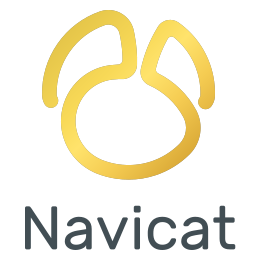

### Hi fellows 👋
- 🔭 I’m currently working on [Monitaz](https://monitaz.com/)
- 📫 How to reach me:

[](https://www.facebook.com/SuBiBi155)
[](https://teams.live.com/l/invite/FEATVANtpU_KFHnfA?v=g1)
[](https://www.linkedin.com/in/ti%E1%BA%BFn-%C4%91%E1%BA%A1t-l%C3%AA-ba267a232/)
[](https://t.me/subibi1505)
[](mailto:tiendat15599.dev@gmail.com)
[](mailto:tiendat15599@yahoo.com.vn)

[comment]: <> (### Spotify Playing 🎧)

[comment]: <> ([]&#40;https://open.spotify.com/user/21wi7t5t4zyugx5mgetrdo7xa&#41;)
### Last.fm Playing 🎧
[](https://www.last.fm/user/tiendat15599)

---

### Tools:



<br>

### Libraries and Frameworks:


<br>

### Databases:


<br>
<br>

---

[comment]: <> (![Lê Tiến Đạt's GitHub stats]&#40;https://github-readme-stats.vercel.app/api?username=tiendat15599&show_icons=true&count_private=true&theme=tokyonight&#41;)
### Development Stats


<!--START_SECTION:waka-->


**🐱 My GitHub Data** 

> 📦 280.8 kB Used in GitHub's Storage 
 > 
> 🏆 15 Contributions in the Year 2026
 > 
> 🚫 Not Opted to Hire
 > 
> 📜 28 Public Repositories 
 > 
> 🔑 27 Private Repositories 
 > 
**I'm an Early 🐤** 

```text
🌞 Morning                709 commits         ████████░░░░░░░░░░░░░░░░░   31.14 % 
🌆 Daytime                606 commits         ███████░░░░░░░░░░░░░░░░░░   26.61 % 
🌃 Evening                630 commits         ███████░░░░░░░░░░░░░░░░░░   27.67 % 
🌙 Night                  332 commits         ████░░░░░░░░░░░░░░░░░░░░░   14.58 % 
```
📅 **I'm Most Productive on Thursday** 

```text
Monday                   242 commits         ███░░░░░░░░░░░░░░░░░░░░░░   10.63 % 
Tuesday                  328 commits         ████░░░░░░░░░░░░░░░░░░░░░   14.40 % 
Wednesday                375 commits         ████░░░░░░░░░░░░░░░░░░░░░   16.47 % 
Thursday                 454 commits         █████░░░░░░░░░░░░░░░░░░░░   19.94 % 
Friday                   384 commits         ████░░░░░░░░░░░░░░░░░░░░░   16.86 % 
Saturday                 150 commits         ██░░░░░░░░░░░░░░░░░░░░░░░   06.59 % 
Sunday                   344 commits         ████░░░░░░░░░░░░░░░░░░░░░   15.11 % 
```


📊 **This Week I Spent My Time On** 

```text
💬 Programming Languages: 
Text                     7 hrs 24 mins       █████████░░░░░░░░░░░░░░░░   35.67 % 
Other                    7 hrs 6 mins        █████████░░░░░░░░░░░░░░░░   34.22 % 
Python                   3 hrs 31 mins       ████░░░░░░░░░░░░░░░░░░░░░   17.01 % 
Markdown                 1 hr 12 mins        █░░░░░░░░░░░░░░░░░░░░░░░░   05.82 % 
PHP                      41 mins             █░░░░░░░░░░░░░░░░░░░░░░░░   03.32 % 

🔥 Editors: 
Claude Code              11 hrs 4 mins       █████████████░░░░░░░░░░░░   53.38 % 
NavicatPremium           2 hrs 24 mins       ███░░░░░░░░░░░░░░░░░░░░░░   11.62 % 
PyCharm                  2 hrs 11 mins       ███░░░░░░░░░░░░░░░░░░░░░░   10.57 % 
FileZillaFTPClient       1 hr 8 mins         █░░░░░░░░░░░░░░░░░░░░░░░░   05.47 % 
MicrosoftOneNote         1 hr 6 mins         █░░░░░░░░░░░░░░░░░░░░░░░░   05.34 % 

💻 Operating System: 
Windows                  19 hrs 14 mins      ███████████████████████░░   92.71 % 
Linux                    1 hr 30 mins        ██░░░░░░░░░░░░░░░░░░░░░░░   07.29 % 
```

🤖 **AI Coding This Week** 

```text
⏱ AI Coding Time: 11 hrs 7 mins (53.61%)

✍️ 35,363 lines written by AI, 62 lines written by hand (99.82% AI-written)

🔤 10,169,711 Input Tokens, 3,889,856 Output Tokens

💵 $185.95 Estimated AI Cost This Week

🧠 18 AI Sessions, 48 AI Prompts

Opus                     35,543 lines        █████████████████████████   100.00 % 

🔎 AI Coding Insights:
🤖 AI-Driven — 99.82% of written lines came from AI
📚 Verbose Prompter — average 3,155 characters per prompt
🔁 Iterative Prompter — average 3 prompts per session
🚀 High AI Trust — 0.19% of changed lines were hand-edited
```

**I Mostly Code in PHP** 

```text
PHP                      20 repos            ███████████████░░░░░░░░░░   58.82 % 
JavaScript               7 repos             █████░░░░░░░░░░░░░░░░░░░░   20.59 % 
Python                   4 repos             ███░░░░░░░░░░░░░░░░░░░░░░   11.76 % 
HTML                     2 repos             █░░░░░░░░░░░░░░░░░░░░░░░░   05.88 % 
Batchfile                1 repo              █░░░░░░░░░░░░░░░░░░░░░░░░   02.94 % 
```


 Last Updated on 08/11/2026 12:58:18 UTC
<!--END_SECTION:waka-->
