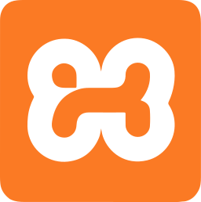
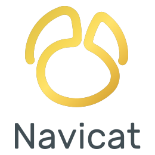

### Hi fellows 👋
- 🔭 I’m currently working on [Monitaz](https://monitaz.com/)
- 📫 How to reach me:

[](https://www.facebook.com/SuBiBi155)
[](https://teams.live.com/l/invite/FEATVANtpU_KFHnfA?v=g1)
[](https://www.linkedin.com/in/ti%E1%BA%BFn-%C4%91%E1%BA%A1t-l%C3%AA-ba267a232/)
[](https://t.me/subibi1505)
[](mailto:tiendat15599.dev@gmail.com)
[](mailto:tiendat15599@yahoo.com.vn)

[comment]: <> (### Spotify Playing 🎧)

[comment]: <> ([]&#40;https://open.spotify.com/user/21wi7t5t4zyugx5mgetrdo7xa&#41;)
### Last.fm Playing 🎧
[](https://www.last.fm/user/tiendat15599)

---

### Tools:






<br>

### Libraries and Frameworks:


<br>

### Databases:


<br>
<br>

---

[comment]: <> (![Lê Tiến Đạt's GitHub stats]&#40;https://github-readme-stats.vercel.app/api?username=tiendat15599&show_icons=true&count_private=true&theme=tokyonight&#41;)
### Development Stats


<!--START_SECTION:waka-->


**🐱 My GitHub Data** 

> 📦 279.3 kB Used in GitHub's Storage 
 > 
> 🏆 15 Contributions in the Year 2026
 > 
> 🚫 Not Opted to Hire
 > 
> 📜 28 Public Repositories 
 > 
> 🔑 26 Private Repositories 
 > 
**I'm an Early 🐤** 

```text
🌞 Morning                709 commits         ████████░░░░░░░░░░░░░░░░░   32.85 % 
🌆 Daytime                606 commits         ███████░░░░░░░░░░░░░░░░░░   28.08 % 
🌃 Evening                574 commits         ███████░░░░░░░░░░░░░░░░░░   26.60 % 
🌙 Night                  269 commits         ███░░░░░░░░░░░░░░░░░░░░░░   12.47 % 
```
📅 **I'm Most Productive on Thursday** 

```text
Monday                   238 commits         ███░░░░░░░░░░░░░░░░░░░░░░   11.03 % 
Tuesday                  320 commits         ████░░░░░░░░░░░░░░░░░░░░░   14.83 % 
Wednesday                367 commits         ████░░░░░░░░░░░░░░░░░░░░░   17.01 % 
Thursday                 420 commits         █████░░░░░░░░░░░░░░░░░░░░   19.46 % 
Friday                   375 commits         ████░░░░░░░░░░░░░░░░░░░░░   17.38 % 
Saturday                 114 commits         █░░░░░░░░░░░░░░░░░░░░░░░░   05.28 % 
Sunday                   324 commits         ████░░░░░░░░░░░░░░░░░░░░░   15.01 % 
```


📊 **This Week I Spent My Time On** 

```text
💬 Programming Languages: 
Other                    11 hrs 44 mins      ██████████░░░░░░░░░░░░░░░   41.84 % 
Python                   6 hrs 45 mins       ██████░░░░░░░░░░░░░░░░░░░   24.09 % 
Markdown                 3 hrs 28 mins       ███░░░░░░░░░░░░░░░░░░░░░░   12.36 % 
JSON                     3 hrs 11 mins       ███░░░░░░░░░░░░░░░░░░░░░░   11.35 % 
PHP                      1 hr 41 mins        ██░░░░░░░░░░░░░░░░░░░░░░░   06.04 % 

🔥 Editors: 
Claude Code              12 hrs 46 mins      ███████████░░░░░░░░░░░░░░   45.54 % 
FileZillaFTPClient       3 hrs 29 mins       ███░░░░░░░░░░░░░░░░░░░░░░   12.42 % 
NavicatPremium           2 hrs 57 mins       ███░░░░░░░░░░░░░░░░░░░░░░   10.52 % 
SSH,Telnet,Rlogin,andSUPD2 hrs 53 mins       ███░░░░░░░░░░░░░░░░░░░░░░   10.31 % 
PhpStorm                 1 hr 56 mins        ██░░░░░░░░░░░░░░░░░░░░░░░   06.90 % 

💻 Operating System: 
Windows                  28 hrs 4 mins       █████████████████████████   100.00 % 
```

🤖 **AI Coding This Week** 

```text
⏱ AI Coding Time: 13 hrs 1 min (46.43%)

✍️ 21,812 lines written by AI, 2,416 lines written by hand (90.03% AI-written)

🔤 8,577,308 Input Tokens, 2,332,143 Output Tokens

💵 $199.78 Estimated AI Cost This Week

🧠 19 AI Sessions, 101 AI Prompts

Opus                     22,209 lines        █████████████████████████   100.00 % 

🔎 AI Coding Insights:
🤖 AI-Driven — 90.03% of written lines came from AI
📄 Detailed Prompter — average 1,001 characters per prompt
🔁 Iterative Prompter — average 5 prompts per session
🚀 High AI Trust — 9.97% of changed lines were hand-edited
```

**I Mostly Code in PHP** 

```text
PHP                      20 repos            ███████████████░░░░░░░░░░   58.82 % 
JavaScript               7 repos             █████░░░░░░░░░░░░░░░░░░░░   20.59 % 
Python                   4 repos             ███░░░░░░░░░░░░░░░░░░░░░░   11.76 % 
HTML                     2 repos             █░░░░░░░░░░░░░░░░░░░░░░░░   05.88 % 
Batchfile                1 repo              █░░░░░░░░░░░░░░░░░░░░░░░░   02.94 % 
```


 Last Updated on 27/10/2026 21:57:37 UTC
<!--END_SECTION:waka-->
